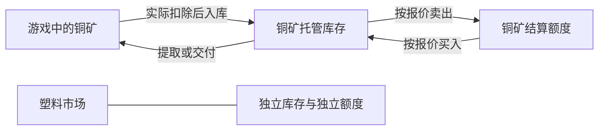

# FXDSP 构想整理与方案评估

日期：2026-10-25。状态：研究后的建议，待用户确定关键取舍。除项目改名与工程检查外，本轮没有实现交易、科技、交付业务。具体市场物品名单留待后续规划。

后续修订：用户已要求改为物品本位的保证金合约，并引入多空和杠杆、不显示结算额度；本文件为现货阶段的历史方案，当前实现见 [0.3.0 验收说明](../acceptance-0.3.0.md)。

**用户已明确的收益目标：禁止跨物品兑换；鼓励通过交易赚取更多同类物品，允许交易收益替代该物品产线。**此前以保护产线为目的提出的有限库存、补货预算和净供给上限不再作为默认要求。以下涉及科技、交易费用、市场深度和交付地区的具体选择仍待规划。

## 1. 用户目标与本轮结论

| 用户目标 | 评估 | 建议 |
| --- | --- | --- |
| 可以从交易平台取得原版物资 | 可行 | 商品现货交易，成交取得货权，再通过库存提取或交付。 |
| 防止低阶资源换矩阵而绕过生产链 | 每物品隔离能够直接约束兑换路径 | 每物品独立结算额度，不设可互换的总钱包；开户不赠送本金。 |
| 技术好的玩家可用交易替代同类物品产线 | 用户明确支持，属于核心玩法目标 | 支持同市场本金复投、长期增长和大规模提取，不用保护产线的供给配额封顶收益。 |
| 每种物品有行情，只先做重点物品 | 可行，不需要逐种重写算法 | 共用行情/报价/账本引擎，每物品配置波动、容量、费用和事件参数。 |
| 100 铜矿/100 塑料等研究解锁 | 有原生代码案例 | 原版能力科技与物品市场认证分层；准确数量要游戏实测。 |
| 前市场盈利可以提前开下一市场 | 可行，但直接跳级会重新破坏目标 | 奖励减免认证、提前申请或小额度；仍保留本体科技和下一物品样本。 |
| 专有科技与可建造的交付箱/塔 | 有专用物流建筑案例 | 原型期绑定普通箱验证，再克隆原型成为专用箱/塔。 |
| UI 尽量贴合原版 | 有成熟开源实现模式 | 原生 UGUI、原版窗口与控件模板、物品图标和工具提示；自制业务与图表。 |

## 2. 应称为哪种交易

当前设想更接近“按物品分开的商品现货市场”，不是外汇货币对。FXDSP 可以继续作为项目名；玩家界面可称“物资交易平台”。

现货要点是买卖当前商品并确认支付/货权，不要求游戏 UI 点击后货物立刻出现在箱子里。可以在成交后先进入玩家托管库存，再按吞吐和容器容量实际交付。[现货概念与订单研究](../research/spot-market-model.md)

建议首版用全额买卖：买入必须有足够额度，卖出必须有该物品。风险表现为卖出后涨价、买回数量减少；无需同时引入杠杆、保证金、裸卖空或爆仓。上一轮 FX 方案中的这些功能不作为本轮先决条件。

## 3. 保留“物品币”的隔离目标，改用两个账户概念

严格的“1 铜币永远双向兑换 1 铜矿”已经固定了相对价格；再提供偏离 1 的交易行情，固定兑换和浮动买卖之间会产生立即可循环的套利。

因此建议每个市场分成：

| 状态 | 玩家如何理解 | 能做什么 |
| --- | --- | --- |
| **托管物品** | 已归玩家所有的铜矿数量 | 直接取回同数量铜矿，或卖给市场。 |
| **铜矿结算额度** | 铜矿卖出所得，仅在铜矿市场有效 | 按当前买入报价买回铜矿；不能按固定比例提取，也不能支付塑料或矩阵。 |

“物品币”仍可作为美术/世界观名称，但说明必须是专用结算额度，而非固定兑换券。无需先创建新的实体货币物品，使用版本化账本保存即可。



铜矿额度与塑料额度之间没有转账或兑换接口。每个市场可显示自身资产，不把信息性的汇总数字变成通用钱包。

### 示例（数值仅用于解释）

先实际存入 100 铜矿，库存为 100、额度为 0。按卖出价 1.00 卖掉，扣 1% 费用后得 99 额度。之后买入报价为 0.80，含 1% 费用可买回 122 铜矿，花 98.576，剩 0.424 额度。交付后实际得到 122 铜矿，比最初多 22。

剩余额度只能继续在铜矿市场使用。若回购报价上涨，就可能买回不足 100 个。开户消耗的认证材料另行记账，不同时作为免费交易本金。

## 4. 收益目标、交易正确性与物流

### 4.1 同类物品增长和产线替代是正向玩法

用户限制的是铁矿不能通过结算账户换白糖等跨物品转换，而不是同类资源的获利规模。玩家取得某种高级物品作为本金后，通过观察行情和承担风险赚回更多同类物品，甚至停止该物品产线，是允许且鼓励的经营路线。

因此本轮修订为：

- **不默认设置保护产线的硬性配额**：有限 NPC 总库存、每日补货、净提现上限及与玩家产量挂钩的限制，均不作为基础规则。
- **支持本金复投与规模增长**：市场可以作为同类物资的持续来源，无需把玩家获利限定为补缺口或小额补给。
- **费用、价差、深度是可选交易玩法**：用于形成成本、风险和下单选择，具体参数待定；不以阻止玩家靠交易替代产线为目的。
- **技术正确性仍是硬要求**：禁止跨市场串账、复制物品、重复发货、舍入铸币，以及同一报价下凭实现缺陷立即往返获利。

采用足额模拟报价方即可支持这个方向，不必先模拟有限 NPC 实物总仓。玩家库存必须来自真实入库或成功买入；合法买入带来的物品增长属于规则授权的产出，不是复制漏洞。大额交易和长期复利应在规则测试中得到支持，不能因设计目标误判而自动截断。

### 4.2 防止免费跨星球传送

本节仍是待讨论的物流建议，不是用户已经确认的硬限制；同类收益可替代产线的决定不自动决定交付地区。

即使币不互通，全局库存任意星球提取仍会替代运输船和翘曲器。仅限制每次交付数量不能解决地理绕过。

建议首版绑定一个**结算星球**：该存档的实物入库和交付都在这里进行；远程查看/操作可以另作 UI 能力，货物跨星球继续用原版物流。数据模型预留 regionId，未来要支持多地区时，再明确库存、额度、价格和运输的地区边界。

不要假定“不同星球库存隔离但余额全球流动”就一定保住物流：异地卖出再异地买入仍可转移资源价值。跨地区结算需在后续明确设计。

## 5. 科技树、市场认证和盈利奖励

### 原生材料科技可行

实际源码表明 TechProto 可使用非矩阵物品作为研究材料，并区分实验室研究和非实验室研究。CommonAPI 的注册方法和 GenesisBook 数据已有实例；当前本地游戏也能找到相应字段。因此“100 铜矿解锁交易接入”的原生科技值得优先验证。[科技源码研究](../research/dsp-progression-delivery.md)

材料总消耗由研究点与消耗比例共同决定，不能直接把某个字段写 100 就视为恰好扣 100。第一项实测应检查新旧档、显示、扣量与手动研究路径。

### 推荐两层进度

1. **能力科技**：交易接入、交付箱、交付物流站等，进入原生科技树并继承本体前置。
2. **市场认证**：每物品的开户材料、交易表现、初始额度/深度等级。可在交易窗口展示，便于表达盈利奖励。

若希望每个物品市场也呈现为科技树节点，可以继续规划；同一个权限必须只有一份权威状态，避免科技和认证分别扣一次材料、分别保存又互相冲突。不通过修改全局 TechProto 原型来给单个存档打折。

建议普通路线是交入规定材料；盈利路线允许提前申请、减免材料或提前开小额度，但二者都应满足：

```text
该物品对应的本体科技已达到
AND 已取得并提交该物品的实体样本
AND 市场认证路线完成（普通材料条件，或前市场成就条件）
```

塑料市场即使因铜市场成就提前开，也不会得到免费塑料或初始塑料额度。玩家仍要先建立必要的生产能力。样本最低数量、认证费用是否消耗/返还，以及成就到底减免多少，留给后续取舍。

### 盈利不要按成交额或充值统计

首版建议用同一物品的**净实物提取增量**作为直观成就指标：

`累计实际交回游戏世界的数量 − 累计从游戏世界实际入库的数量`。

它不是严格的财务会计利润，尚未提取的库存、额度和浮盈也不算；因此较保守，需要先取回本金才变正。取出 122、最初投入 100，则是 +22；把 122 再存入并原样取出，指标仍是 +22。已认证权限按历史最高水位一次性解锁，不按每笔正回款反复累加，也不把不同物品的额度直接相加。

## 6. 交付平台：最终形态可做专用箱/塔

已有 Mod 克隆原版物流站原型创建专用物资交换站，并按容量部分交付。正式版的“可研究、可建造、直接接流水线”的交付终端有实现基础。[专用物流站与交付案例](../research/dsp-progression-delivery.md)

推荐顺序：

1. 绑定一个普通箱子，验证入库、取货、库存、存档和队列。
2. 克隆原版箱子原型成为专用交付箱，通过分拣器连接产线。
3. 再做专用交付物流站，使用原版槽位、无人机和运输船。
4. 新外观模型、远程交付等能力按需求单独扩展。

交付的关键规则：

- 成交时只扣一次额度并确认货权；交付不再次按行情买入。
- 箱满只暂停，部分插入只扣实际插入数量，余量保留。
- 建筑拆除、槽位改品种、实体 ID 回收时暂停并允许重绑，不把已交付物品再返还。
- 同一份数量在可用、预留、待交付、已交付之间有明确状态，不能同时用于卖出和发货。
- 首版新购物品不凭空带增产点；玩家带增产物资入库如何处理需要明确规则，不能静默复制增产效果。
- 业务更新在游戏允许的线程/时机完成；原型期不每帧扫描全星系所有箱和塔。
- 原版存档和 Mod 旁档需匹配快照，缺档或不匹配时暂停自动交付并进入可解释的恢复流程。订单幂等只能解决一部分重复操作问题。

## 7. 技术架构：共用引擎，不逐物品堆代码

| 模块 | 责任 | 与游戏的边界 |
| --- | --- | --- |
| MarketDefinition / MarketState | 少量选定物品的参数、状态、库存和时间 | 用稳定物品 ID、市场 ID；预留地区与版本。 |
| QuoteEngine / TradeService | 统一行情、可执行报价、深度、费用和成交 | 纯逻辑，不读写 UI 和仓储数组。 |
| Ledger / Custody | 隔离额度、托管物品、预留和流水 | 保证整数物品、非负余额、同市场结算与请求去重。 |
| Progression | 原生科技前置、认证、成就和权限 | 游戏科技读取走适配层；认证状态随档保存。 |
| Delivery / GameIntegration | 背包、箱、塔与已绑定端点 | 接收量驱动扣账，处理生命周期和增产点。 |
| Persistence | 快照、版本、随机状态、交付游标 | 与存档和 F6 状态迁移一致。 |
| Native UI | 原版风格窗口、图表和交付界面 | 显示只读快照，提交指令，业务再次校验。 |

这是职责划分，不要求首版拆成七个 DLL。当前单 DLL 工程足够，先保持逻辑可独立测试。固定精度、checked 溢出校验、明确费用舍入和整数货物应从第一笔交易就确定。

所有市场共用行情机制，各自配置基础波动、事件权重和深度。用游戏逻辑时间推进，暂停/退出时不悄悄运行；保存随机状态和事件，普通读档或 F6 不重新抽价格和刷新容量。价差与费用让即刻往返交易付出成本，不能用玩家自己抬高显示价的方式制造收益。

## 8. 原版风格 UI 的落地方向

从 UXAssist 学习窗口外壳、控件工厂和本地化；从 LSTM 学习物流站式物品行、滚动列表与更新节流。参考已固定到具体提交，保存了精选文件和许可证。[UI 研究](../research/dsp-native-ui.md)

建议布局：左侧物品列表，中部价格曲线，右侧买卖、可用库存和本市场额度，下方页签显示记录、认证和交付队列。图标、字体、背景、按钮、工具提示和容量条沿用原版风格；图表先用同风格折线，按数据变化重绘。

窗口显示、行情更新和物流处理各有自己的节奏。关闭窗口不停止必要业务，也不继续无意义绘制；暂停时不暗中撮合。ESC、数量输入、鼠标滚轮、分辨率、UI 缩放与 F6 后对象清理是首个 UI 原型的验收项目。

## 9. 研发顺序与本轮交付

1. **规则验证**：一个抽象物品市场，验证隔离、费用、即刻往返、大额交易、拆单和长期本金复投。不先填完整物品名单。
2. **游戏内闭环**：原版风格小窗口，一个市场的实物入库、交易、提取和随档保存。
3. **科技与箱子**：原生材料科技、市场认证、一个普通箱子的可恢复交付。
4. **专用交付与内容**：可建造交付箱/塔、重点物品配置与事件、扩容和盈利奖励。

第一版不必同时做所有高级委托和金融品种。每一步都应能在游戏里单独试玩，再判断交易节奏是否支持造厂。

本轮已完成：工程改名、构建验证、三组研究文档与来源缓存、架构评估。用户已确认允许通过市场收益替代同类产线。待确认：隔离额度命名、认证费用与本金、盈利奖励力度、行情风险与费用、可选市场深度、交付地区、增产物资规则、首批重点物品。尚未实现上述业务。
